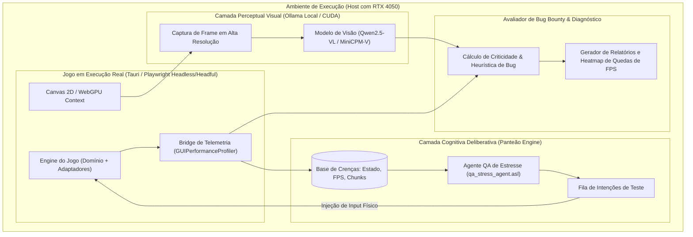
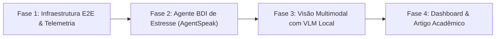

# Especificação de Requisitos: Suíte E2E Híbrida de QA & Performance com Agentes Cognitivos BDI e Visão Computacional (VLM)

> **Documento Canônico de Pesquisa & Engenharia:** `docs/AI_AGENTIC_QA_E2E_REQUIREMENTS.md`  
> **Classificação:** Arquitetura de Testes Automatizados E2E / Inteligência Artificial Aplicada a Jogos  
> **Status:** Especificação Aprovada para Desenvolvimento Futuro  
> **Target de Hardware:** NVIDIA GeForce RTX 4050 (6GB GDDR6 / Tensor Cores / Aceleração CUDA Local)

---

## 1. Visão Geral e Contexto Acadêmico-Científico

Este documento formaliza a arquitetura, os requisitos funcionais e não funcionais para uma suíte de testes de ponta a ponta (**End-to-End - E2E**) automatizada por Inteligência Artificial no *rpg-roguelite-game*. 

A proposta combina duas abordagens de ponta da computação moderna em um modelo híbrido:
1. **Sistemas Multiagentes Cognitivos (MAS / BDI em Jason & Panteão Engine)**: Responsáveis pelo raciocínio lógico deliberativo, planejamento de metas de estresse e exploração sistemática do espaço de estados do jogo.
2. **Modelos de Linguagem e Visão Locais (Vision-Language Models - VLM via Ollama + CUDA)**: Responsáveis pela inspeção perceptual dos frames renderizados na tela (detecção de anomalias visuais, quebra de HUD, flickering e artefatos de renderização no Canvas 2D/WebGPU).

### 1.1. Objetivos da Pesquisa
- **Automação Inteligente de QA**: Substituir testes E2E puramente scripted por agentes capazes de encontrar *edge cases*, *softlocks* e quebras de colisão de forma autônoma.
- **Profiling e Estresse Contínuo**: Submeter o motor do jogo (física determinística Zero-GC, transição de chunks, renderizador de iluminação) a cenários caóticos de alta densidade de entidades e efeitos.
- **Detecção Multimodal de Defeitos**: Correlacionar quedas de framerate e picos de heap memory com inspeção visual de anomalias gráficas (ex: artefatos na costura de chunks, telas cinzas de transição).

---

## 2. Arquitetura da Solução Híbrida (BDI + VLM)

---

## 3. Componentes da Arquitetura

### 3.1. Orquestrador E2E (Playwright / Tauri WebDriver)
- **Função:** Executa o ciclo de vida real da aplicação gráfica.
- **Capacidades:**
  - Inicializa o jogo apontando para o ambiente Vite local (`http://localhost:5173`) ou pacote nativo Tauri.
  - Injeta inputs em nível de sistema operacional (pressionar teclas `W`, `A`, `S`, `D`, `Space`, mouse click, drag de inventário) com latência controlada.
  - Expõe uma ponte de comunicação com o DOM e o Canvas (`page.evaluate()`) para extrair snapshots e buffers de telemetria.

### 3.2. Agente Cognitivo BDI (Panteão Engine / AgentSpeak)
- **Função:** Tomada de decisão lógica baseada no ciclo *Beliefs-Desires-Intentions*.
- **Estrutura de Crenças (`Beliefs`):**
  - `at(PlayerX, PlayerY)`: Posição espacial atual no mapa.
  - `active_chunk(CX, CY)`: Chunk lógico carregado.
  - `fps(CurrentFPS, FrameTimeMs)`: Métrica de performance instantânea.
  - `memory_heap(HeapUsedMB)`: Uso de memória JavaScript V8.
  - `entities_count(Enemies, Projectiles, Particles)`: Densidade do mundo.
- **Catálogo de Desejos e Planos de Estresse (`Plans`):**
  - `!stress_chunk_seam`: Tenta repetidamente atravessar quinas diagonais e costuras de chunks enquanto dispara ataques rápidos.
  - `!burst_spell_density`: Dispara magias de área com cooldown zerado para forçar picos de draw calls no canvas.
  - `!rapid_modal_thrashing`: Abre e fecha o `CharacterMenuGui`, menu de opções e modais em intervalos de 5ms para verificar event listeners duplicados.
  - `!long_distance_path_walk`: Percorre longas distâncias atravessando múltiplos chunks consecutivamente para verificar se chunks antigos são desalocados do garbage collector.

### 3.3. Agente de Percepção Visual (VLM Local via Ollama na RTX 4050)
- **Função:** Avaliação estética e semântica do frame desenhado.
- **Parâmetros Operacionais na RTX 4050:**
  - Modelo recomendado: `Qwen2.5-VL:7b` (quantizado em Q4_K_M) ou `MiniCPM-V:8b`.
  - Consumo de VRAM estimado: $\approx 4.2\text{GB}$ a $4.8\text{GB}$.
  - Margem para o jogo e sistema: $\approx 1.2\text{GB}$ livres.
- **Critérios de Inspeção Visual do VLM:**
  - **Detecção de Gray Screen / Black Screen**: O canvas parou de renderizar o cenário e está exibindo uma cor sólida (falha de pipeline).
  - **Glitches de Layer / Z-Fighting**: Sobreposição incorreta de assets (ex: personagem desenhado atrás do chão ou dentro de telhados sem transparência).
  - **Quebra de HUD / Interface**: Textos cortados, números de dano persistentes congelados na tela ou botões ilegíveis.
  - **Artefatos de Costura**: Linhas pretas visíveis entre as bordas dos chunks de grama ou estradas.

---

## 4. Função de Recompensa & Heurística de Detecção de Bugs (*Bug Bounty*)

O sistema avalia cada intervalo de teste ($\Delta t = 250\text{ms}$) atribuindo uma pontuação de anomalia ($S_{\text{bug}}$):

$$S_{\text{bug}} = w_1 \cdot \Delta_{\text{FPS}} + w_2 \cdot M_{\text{leak}} + w_3 \cdot C_{\text{desync}} + w_4 \cdot E_{\text{uncaught}} + w_5 \cdot V_{\text{glitch}}$$

Onde:
- **$\Delta_{\text{FPS}}$ (Queda Brusca de Framerate)**:
  - Se $\text{FPS}_{\text{atual}} < 0.6 \times \text{FPS}_{\text{baseline}}$: pontuação proporcional à severidade da queda.
- **$M_{\text{leak}}$ (Tendência de Vazamento de Memória)**:
  - Crescimento monotônico do heap do processo ao longo de 5 transições sucessivas de mapa sem retorno após GC.
- **$C_{\text{desync}}$ (Inconsistência de Colisão)**:
  - Posição $(x, y)$ do jogador localizada no interior geométrico de um polígono com `type: 'solid'` sem estado de teleporte ativo.
- **$E_{\text{uncaught}}$ (Exceção de Runtime)**:
  - Interceptação de eventos no `window.onerror` ou mensagens `console.error`.
- **$V_{\text{glitch}}$ (Anomalia Visual Classificada pelo VLM)**:
  - Classificação com confiança $\ge 85\%$ emitida pelo modelo de visão indicando artefato gráfico severo.

---

## 5. Requisitos Funcionais (RF)

- **RF-01 (Exportação da Telemetria de Runtime):** O motor de renderização (`GUIPerformanceProfiler` / `GameAdapter`) deve disponibilizar em `window.__GAME_PERF_METRICS__` um snapshot imutável a cada frame contendo FPS, frame time (ms), total de entidades ativas, draw calls por camada e heap memory.
- **RF-02 (Driver de Injeção E2E com Playwright):** Deve existir uma suíte automatizada capaz de inicializar o servidor Vite ou binário Tauri, controlar a janela e emitir eventos de mouse/teclado sem interferência humana.
- **RF-03 (Bridge Panteão MAS - Playwright):** Comunicação bidirecional entre o agente AgentSpeak (`.asl`) e a sessão do Playwright via WebSocket ou canal de mensagens local IPC, convertendo intenções cognitivas em ações de entrada física.
- **RF-04 (Coletor e Bufferizador de Frames):** O runner deve capturar screenshots do Canvas em formato PNG/Buffer a cada evento de interesse ou a cada $N$ frames e armazená-los para análise multimodal.
- **RF-05 (Conector VLM Local Ollama):** Um cliente HTTP assíncrono que consome a API do Ollama (`POST /api/generate` com payload de imagem em base64) executando em GPU local na porta 11434.
- **RF-06 (Gerador de Relatórios Acadêmicos & Diagnósticos):** Ao término da sessão de teste, a suíte deve gerar automaticamente:
  - Um gráfico em linha contendo a variação de Frametime ao longo do tempo.
  - Um *Heatmap* 2D do mapa de Vilgem indicando as coordenadas $(x, y)$ onde ocorreram as maiores quedas de framerate ou falhas de colisão.
  - Galeria de screenshots dos bugs detectados acompanhados do laudo descritivo emitido pelo VLM.

---

## 6. Requisitos Não Funcionais (RNF)

- **RNF-01 (Orçamento de VRAM na RTX 4050):** O uso combinado do jogo (Canvas/WebGPU) e do modelo de IA (VLM no Ollama) não deve ultrapassar $5.2\text{GB}$ de VRAM para evitar *thrashing* de memória compartilhada do sistema operacional.
- **RNF-02 (Isolamento de Estado):** As sessões de teste da IA devem utilizar perfis temporários de save (`save_e2e_temp.json`) e storage isolado, sem poluir os saves de produção do usuário.
- **RNF-03 (Determinismo e Reprodutibilidade):** Quando um bug for descoberto, a suíte deve salvar a semente do gerador pseudo-aleatório (PRNG Seed) e a lista ordenada de timestamps e teclas pressionadas para permitir replay exato do erro.
- **RNF-04 (Conformidade com a Arquitetura Hexagonal):** A integração da suíte E2E deve respeitar as fronteiras do projeto: nenhuma lógica de teste da IA deve residir no Domínio puro (`typescript/domain/`), conectando-se apenas através de adaptadores e portas de telemetria.

---

## 7. Roadmap de Implementação em Fases

1. **Fase 1: Infraestrutura E2E & Telemetria**
   - Configurar o runner do Playwright para o ambiente Vite do projeto.
   - Expor o canal `window.__GAME_PERF_METRICS__` no `GUIPerformanceProfiler`.
   - Implementar script básico de estresse físico com injeção de teclas.

2. **Fase 2: Agente BDI de Estresse (AgentSpeak & Panteão Engine)**
   - Criar o agente `qa_stress_agent.asl` com os planos de busca por quinas, transições rápidas e spam de magias.
   - Integrar o ciclo de deliberação BDI ao driver do Playwright.

3. **Fase 3: Visão Multimodal com VLM Local (Ollama + RTX 4050)**
   - Integrar o cliente do Ollama com modelo multimodal (`Qwen2.5-VL` ou `MiniCPM-V`).
   - Implementar o filtro de frames suspeitos (disparado por $\Delta_{\text{FPS}} > 30\%$ ou colisão inválida).
   - Gerar prompt de análise de cena e classificação de defeitos visuais.

4. **Fase 4: Dashboard & Artigo Acadêmico**
   - Implementar gerador de HTML com heatmaps de anomalias no mapa de Vilgem.
   - Consolidar métricas comparativas (tempo para encontrar bugs: humano vs. IA BDI+VLM).
   - Documentar resultados para publicação acadêmica em conferências de jogos / SBGames / IEEE CoG.
