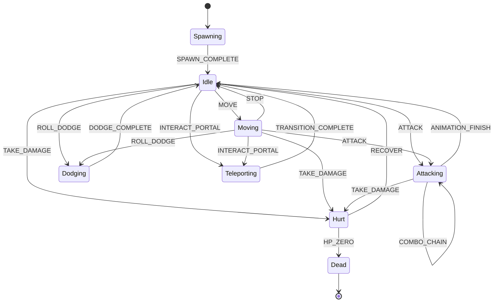
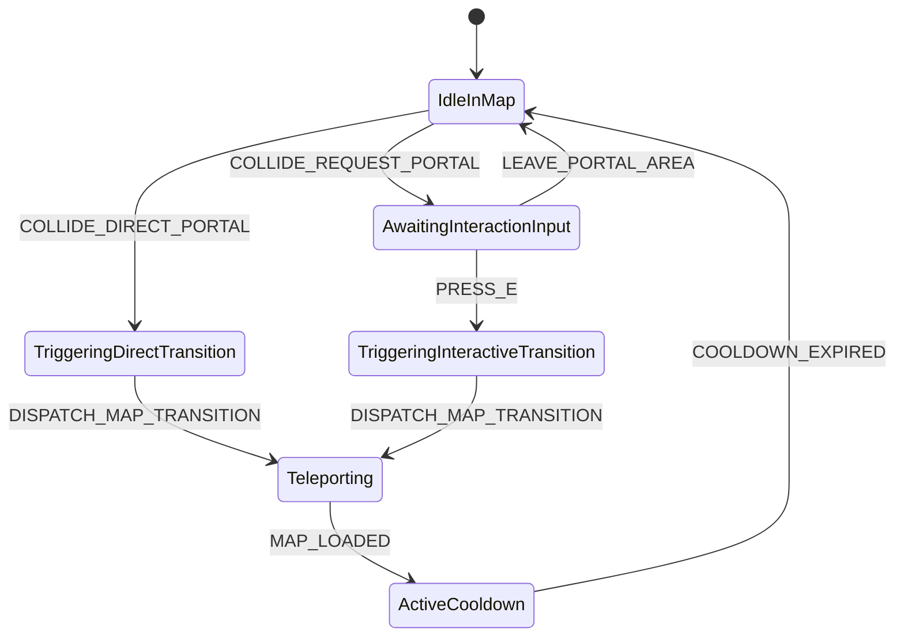
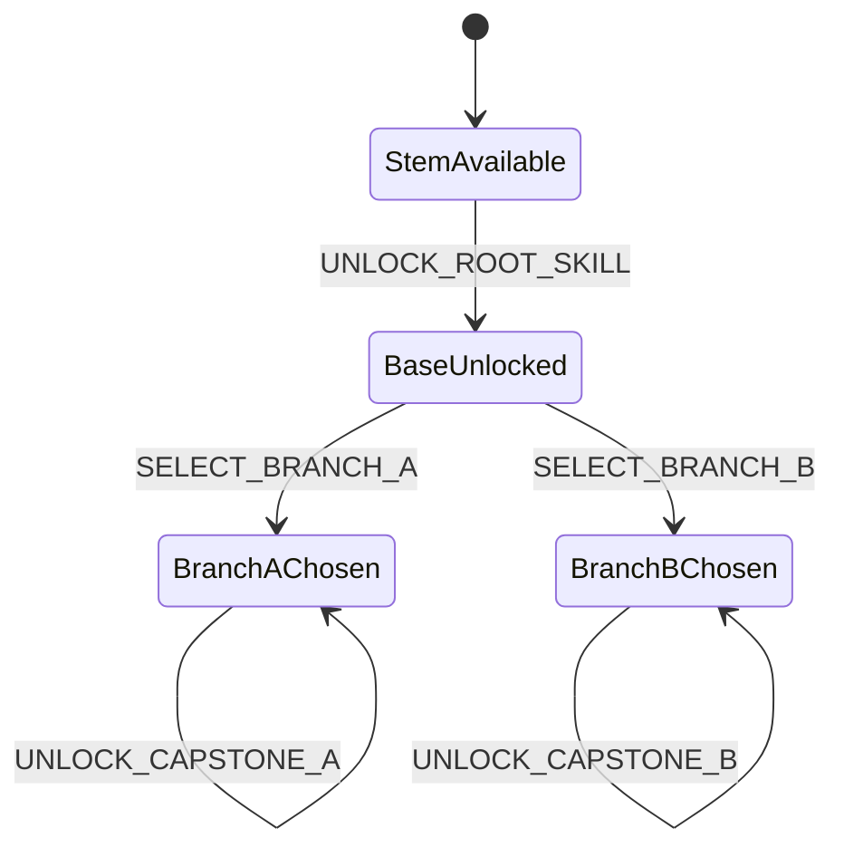
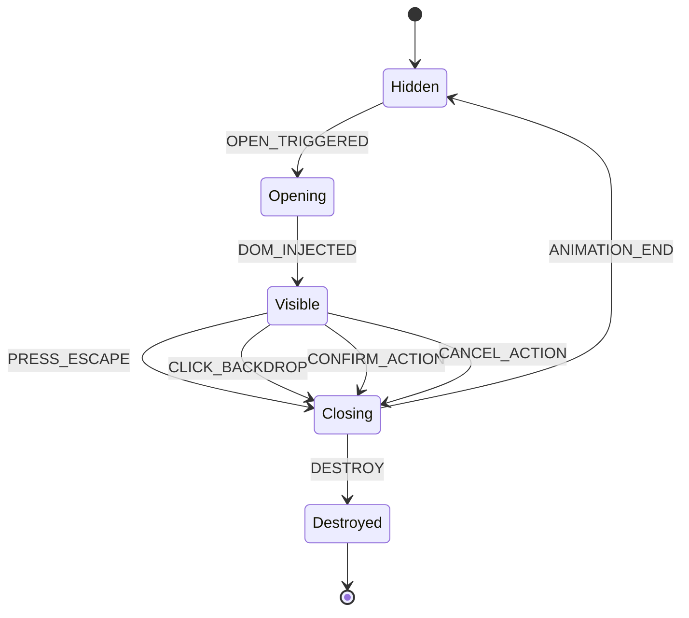
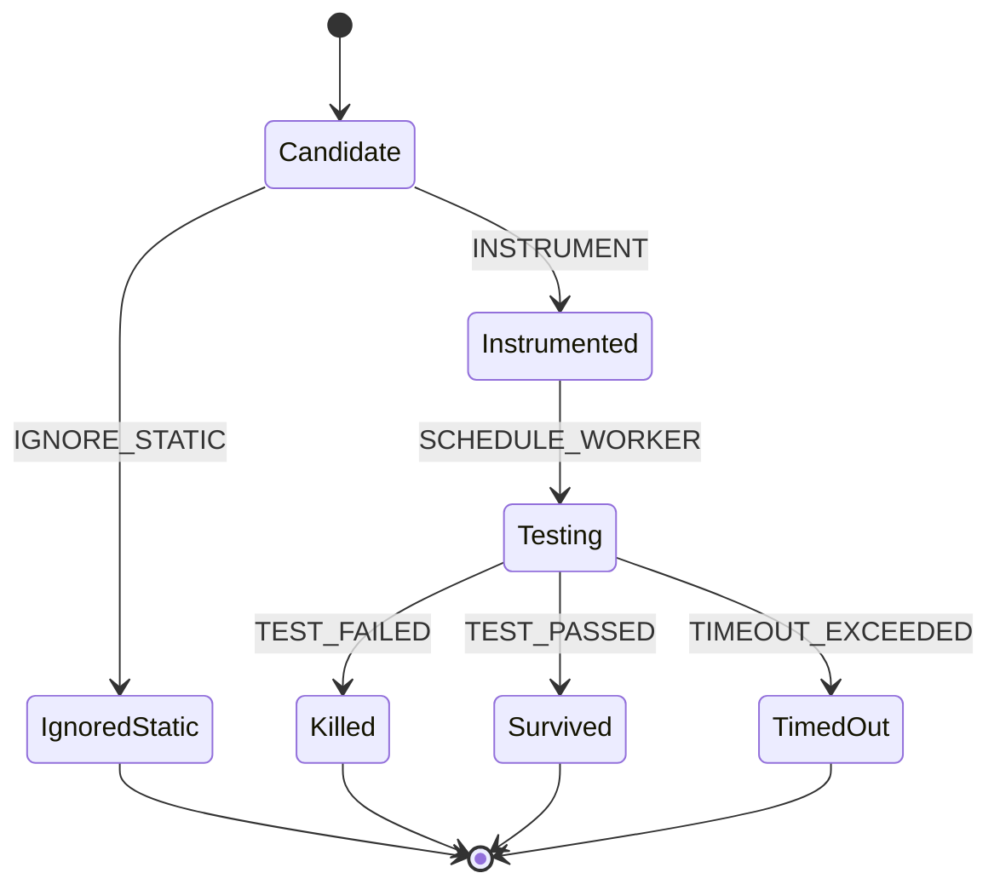
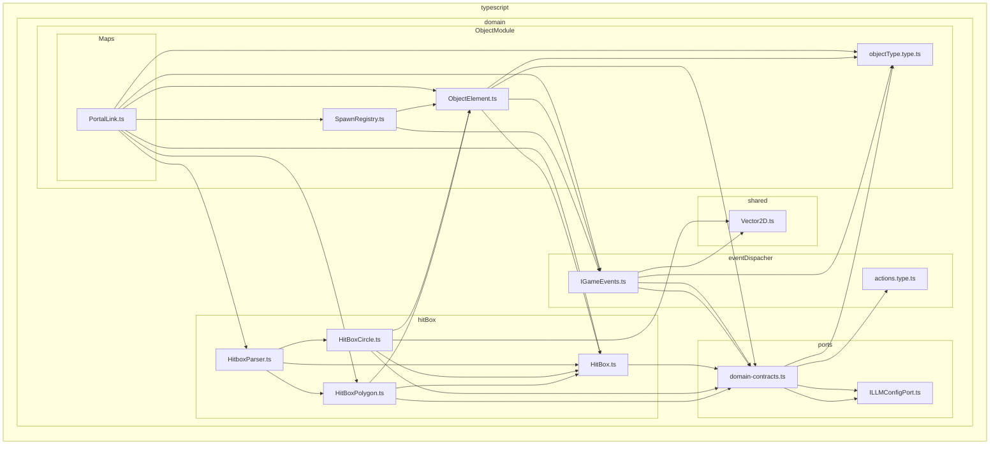
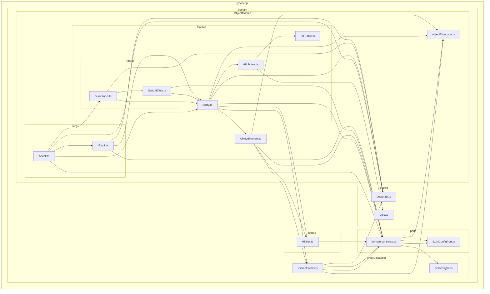
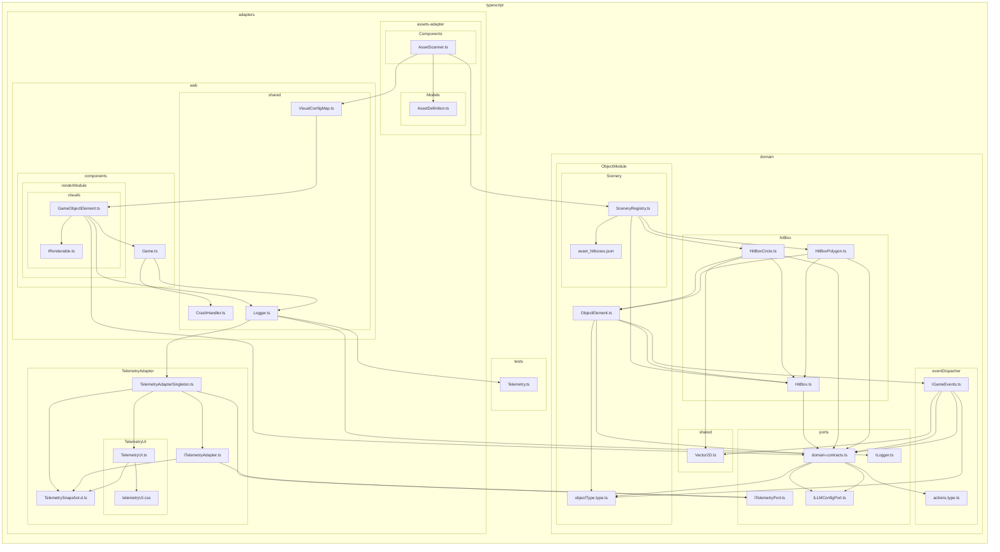

# Documentação Completa e Espelhada de Diagramas do Projeto

> **Origem dos Dados**: Gerado 100% de forma determinística por ferramentas de AST e Autômatos de Terceiros (`dependency-cruiser`, `@optave/codegraph`, `xstate`).  
> **Garantia de Integridade**: Zero alucinação manual por LLM. Se o código fonte for refatorado, os diagramas são atualizados automaticamente via `npm run diagrams:update`.

---

## 1. Diagramas de Estados Formais (`docs/diagrams/states/`)

### 1.1 Ciclo de Vida do Jogador (Player State Machine)
Origem: [`docs/diagrams/states/player-states.mmd`](./states/player-states.mmd)


### 1.2 Transição de Portais & InnerMaps
Origem: [`docs/diagrams/states/portal-transition.mmd`](./states/portal-transition.mmd)


### 1.3 Exclusividade e Ramificação da Árvore de Habilidades (Skill Tree)
Origem: [`docs/diagrams/states/skilltree-branching.mmd`](./states/skilltree-branching.mmd)


### 1.4 Ciclo de Vida de Modais e GUIs (UIManager)
Origem: [`docs/diagrams/states/gui-lifecycle.mmd`](./states/gui-lifecycle.mmd)


### 1.5 Ciclo de Vida do Mutante de Teste (Stryker Mutator)
Origem: [`docs/diagrams/states/mutant-lifecycle.mmd`](./states/mutant-lifecycle.mmd)


---

## 2. Grafos Arquiteturais de Dependência (`docs/diagrams/architecture/`)

### 2.1 Visão Geral do Domínio (`DomainFacade`)
```mermaid
flowchart LR

subgraph 0["typescript"]
subgraph 1["domain"]
2["DomainFacade.ts"]
3["DialogueGateway.ts"]
subgraph 4["ObjectModule"]
5["ObjectElementManager.ts"]
8["objectType.type.ts"]
H["CollisionManager.ts"]
subgraph I["Entities"]
subgraph J["Player"]
K["Player.ts"]
subgraph 13["Classes"]
14["Class.ts"]
1S["Gunslinger.ts"]
1T["Mage.ts"]
24["Necromancer.ts"]
2C["NecromancerSkillsBuilder.ts"]
2D["Pescador.ts"]
2I["Warrior.ts"]
2J["WarriorSkillsBuilder.ts"]
end
subgraph 18["components"]
19["BroochRegistry.ts"]
1Q["PlayerClassManager.ts"]
2L["PlayerBroochManager.ts"]
2M["PlayerEquipment.ts"]
4V["PlayerInventory.ts"]
end
2K["IPlayerContext.ts"]
end
T["Attributes.ts"]
V["IXPTable.ts"]
12["Entity.ts"]
subgraph 1C["Status"]
1D["BlindStatus.ts"]
1E["StatusEffect.ts"]
1F["BurnStatus.ts"]
1G["FearStatus.ts"]
1H["FreezeStatus.ts"]
1I["ParalyzeStatus.ts"]
1J["PoisonStatus.ts"]
1K["SlowStatus.ts"]
1L["StunStatus.ts"]
1M["VulnerableStatus.ts"]
2B["DecayStatus.ts"]
end
1R["DefaultXPTable.ts"]
subgraph 2E["Casted"]
2F["Leviata.ts"]
end
subgraph 4G["projectiles"]
4H["Bullet.ts"]
4I["Projectile.ts"]
end
end
O["ObjectElement.ts"]
subgraph Y["Items"]
Z["Item.ts"]
subgraph 10["Effects"]
11["Effect.ts"]
2A["AttributeBoostEffect.ts"]
3D["AddCoinsEffect.ts"]
3G["PowerBoostEffect.ts"]
3K["ExperienceEffect.ts"]
3N["HealEffect.ts"]
3O["ManaRestoreEffect.ts"]
3R["SizeBoostEffect.ts"]
3T["SpeedBoostEffect.ts"]
3X["VampirismEffect.ts"]
end
1N["Attack.ts"]
1O["IAtack.ts"]
subgraph 2N["Armors"]
2O["Armor.ts"]
subgraph 2Q["boots"]
2R["IronBoots.ts"]
2S["Boots.ts"]
end
subgraph 2T["chestplates"]
2U["IronChestplate.ts"]
2V["Chestplate.ts"]
end
subgraph 2W["glooves"]
2X["IronGloves.ts"]
2Y["Gloove.ts"]
end
subgraph 2Z["helmet"]
30["IronHelmet.ts"]
31["Helmet.ts"]
end
subgraph 32["necklaces"]
33["SimpleAmulet.ts"]
34["Necklace.ts"]
end
subgraph 35["pants"]
36["IronPants.ts"]
37["Pants.ts"]
end
subgraph 38["rings"]
39["SimpleRing.ts"]
3A["Ring.ts"]
end
end
2P["ItemFactory.ts"]
subgraph 3B["Consumables"]
3C["Coin.ts"]
3E["Consumable.ts"]
3F["DemonBlood.ts"]
subgraph 3H["Potions"]
3I["Potions.ts"]
3S["AdrenalineFlask.ts"]
3U["HealthPotion.ts"]
3V["ManaPotion.ts"]
end
3J["ExperienceTome.ts"]
subgraph 3L["Food"]
3M["Apple.ts"]
3P["Food.ts"]
end
3Q["MegaMushroom.ts"]
3W["VampireFang.ts"]
end
subgraph 3Y["Storage"]
3Z["LeatherBag.ts"]
40["Bag.ts"]
41["Storage.ts"]
42["LeatherBelt.ts"]
43["Belt.ts"]
end
subgraph 44["Tools"]
45["Tool.ts"]
46["Axe.ts"]
47["Hammer.ts"]
48["Hoe.ts"]
49["WateringCan.ts"]
end
subgraph 4A["Weapons"]
subgraph 4B["MeleeWeapons"]
4C["Scythe.ts"]
4D["MeleeWeapon.ts"]
4J["ScytheSlash.ts"]
4K["AnimatedMeleeAttack.ts"]
4M["SimpleSword.ts"]
4N["Sword.ts"]
end
4E["Weapon.ts"]
subgraph 4O["RangedWeapons"]
4P["FishingRod.ts"]
4Q["RangedWeapon.ts"]
4R["Gun.ts"]
subgraph 4S["Staffs"]
4T["SimpleStaff.ts"]
4U["Staff.ts"]
end
end
end
51["RewardGenerator.ts"]
end
2H["SpawnRegistry.ts"]
4W["EnvironmentCollider.ts"]
subgraph 4X["Maps"]
4Y["PortalLink.ts"]
4Z["PortalLinkRequest.ts"]
subgraph 56["PortalLinks"]
57["portalLinksMap.ts"]
end
5D["IntermapConfig.ts"]
5E["IntermapWorld.ts"]
5F["VilgemWorld.ts"]
end
50["RewardManager.ts"]
55["GameWorld.ts"]
end
subgraph 6["eventDispacher"]
7["IGameEvents.ts"]
B["actions.type.ts"]
L["ActionBindings.ts"]
52["ActionManager.ts"]
end
subgraph 9["ports"]
A["domain-contracts.ts"]
C["ILLMConfigPort.ts"]
F["ICollisionService.ts"]
G["ITelemetryPort.ts"]
Q["ISaveRepository.ts"]
W["ILogger.ts"]
15["IClass.ts"]
4F["IWeapon.ts"]
end
subgraph D["shared"]
E["Vector2D.ts"]
U["Dice.ts"]
end
subgraph M["hitBox"]
N["HitBoxCircle.ts"]
P["HitBox.ts"]
2G["HitBoxPolygon.ts"]
4L["HitboxParser.ts"]
end
subgraph R["facadeComponents"]
S["MetaProgressionManager.ts"]
X["MetaProgressionMap.ts"]
53["DomainMCPAdapter.ts"]
54["DomainRenderState.ts"]
59["InventoryGateway.ts"]
5A["LocalRewardGenerator.ts"]
5B["SkillTreeGateway.ts"]
5C["ToolActionGateway.ts"]
end
subgraph 16["Skills"]
17["Skill.ts"]
58["SkillBranchManager.ts"]
end
subgraph 1A["templates"]
1B["AttackBuilder.ts"]
1P["BroochTemplate.ts"]
subgraph 1U["mage"]
1V["MageSpellCraftingRegistry.ts"]
1W["ISpellCraftingContracts.ts"]
1X["MageSpellTemplate.ts"]
1Y["RuneGrammarEngine.ts"]
subgraph 1Z["spells"]
20["AbyssalDemonSpell.ts"]
22["BladeInfusions.ts"]
23["NegationSpells.ts"]
end
end
21["TransformationTemplate.ts"]
subgraph 25["attacks"]
26["ChanneledBeamAttackTemplate.ts"]
27["NovaBurstAttackTemplate.ts"]
28["OrbitalAttackTemplate.ts"]
29["SweepingArcAttackTemplate.ts"]
end
end
subgraph 5G["services"]
5H["AutoSaveService.ts"]
end
end
end
2-->3
2-->52
2-->B
2-->7
2-->53
2-->54
2-->59
2-->5A
2-->S
2-->5B
2-->5C
2-->T
2-->K
2-->55
2-->5D
2-->5E
2-->5F
2-->5
2-->A
2-->F
2-->C
2-->W
2-->Q
2-->G
2-->5H
3-->5
3-->W
5-->7
5-->A
5-->F
5-->G
5-->G
5-->H
5-->K
5-->4W
5-->4Y
5-->4Z
5-->O
5-->50
5-->2H
7-->8
7-->A
7-->A
7-->E
A-->B
A-->8
A-->C
A-->C
H-->F
H-->G
H-->G
H-->K
H-->O
K-->L
K-->7
K-->N
K-->A
K-->Q
K-->E
K-->Z
K-->O
K-->T
K-->T
K-->12
K-->12
K-->14
K-->14
K-->19
K-->1Q
K-->2M
K-->4V
L-->B
N-->O
N-->A
N-->E
N-->P
O-->7
O-->P
O-->A
O-->8
P-->A
Q-->S
S-->7
S-->T
S-->W
S-->X
T-->U
T-->V
X-->T
Z-->T
Z-->11
11-->12
12-->7
12-->P
12-->A
12-->E
12-->O
12-->8
12-->T
14-->7
14-->A
14-->15
14-->17
14-->V
15-->V
15-->17
17-->B
17-->11
19-->E
19-->1B
19-->1P
19-->1F
1B-->7
1B-->12
1B-->1D
1B-->1F
1B-->1G
1B-->1H
1B-->1I
1B-->1J
1B-->1K
1B-->1L
1B-->1M
1B-->1N
1B-->11
1B-->1O
1B-->A
1B-->E
1D-->12
1D-->1E
1E-->A
1E-->12
1F-->E
1F-->12
1F-->1E
1G-->12
1G-->1E
1H-->12
1H-->1E
1I-->12
1I-->1E
1J-->E
1J-->12
1J-->1E
1K-->12
1K-->1E
1L-->12
1L-->1E
1M-->12
1M-->1E
1N-->A
1N-->E
1N-->12
1N-->1F
1N-->1O
1O-->A
1O-->E
1O-->12
1P-->7
1P-->X
1Q-->7
1Q-->Q
1Q-->1R
1Q-->14
1Q-->1S
1Q-->1T
1Q-->24
1Q-->2D
1Q-->2I
1Q-->2K
1Q-->19
1Q-->2L
1R-->V
1S-->7
1S-->A
1S-->E
1S-->17
1S-->1N
1S-->V
1S-->14
1T-->L
1T-->B
1T-->7
1T-->A
1T-->E
1T-->17
1T-->1V
1T-->V
1T-->14
1V-->B
1V-->7
1V-->12
1V-->1N
1V-->1O
1V-->A
1V-->E
1V-->1W
1V-->1X
1V-->1Y
1V-->20
1V-->22
1V-->23
1W-->1X
1X-->B
1X-->7
1X-->12
1X-->1N
1X-->1O
1X-->A
1X-->E
1X-->1Y
1Y-->B
20-->12
20-->21
20-->1W
20-->1X
21-->7
21-->12
22-->1W
23-->1W
24-->7
24-->A
24-->E
24-->17
24-->26
24-->27
24-->28
24-->29
24-->1N
24-->2A
24-->V
24-->2B
24-->1G
24-->1J
24-->1K
24-->1L
24-->1M
24-->14
24-->2C
26-->7
26-->12
26-->1N
26-->E
27-->7
27-->12
27-->1N
27-->E
28-->7
28-->12
28-->1N
28-->E
29-->7
29-->12
29-->1N
29-->E
2A-->T
2A-->12
2A-->11
2B-->E
2B-->12
2B-->1E
2C-->17
2C-->2A
2D-->L
2D-->B
2D-->7
2D-->P
2D-->A
2D-->E
2D-->17
2D-->1N
2D-->2F
2D-->12
2D-->V
2D-->1L
2D-->14
2F-->7
2F-->2G
2F-->E
2F-->1N
2F-->O
2F-->2H
2F-->T
2F-->12
2G-->O
2G-->A
2G-->P
2H-->7
2H-->O
2I-->7
2I-->A
2I-->E
2I-->17
2I-->27
2I-->28
2I-->29
2I-->1N
2I-->2A
2I-->V
2I-->1K
2I-->1L
2I-->1M
2I-->14
2I-->2J
2J-->17
2J-->2A
2K-->A
2K-->Z
2K-->T
2L-->7
2L-->1P
2L-->19
2M-->7
2M-->Q
2M-->2O
2M-->Z
2M-->2P
2M-->40
2M-->43
2M-->45
2M-->4E
2M-->2K
2O-->T
2O-->11
2O-->Z
2P-->Q
2P-->2R
2P-->2U
2P-->2X
2P-->30
2P-->33
2P-->36
2P-->39
2P-->3C
2P-->3F
2P-->3J
2P-->3M
2P-->3Q
2P-->3S
2P-->3U
2P-->3V
2P-->3W
2P-->Z
2P-->Z
2P-->3Z
2P-->42
2P-->46
2P-->47
2P-->48
2P-->49
2P-->4C
2P-->4M
2P-->4P
2P-->4R
2P-->4T
2R-->2S
2S-->T
2S-->11
2S-->Z
2S-->2O
2U-->2V
2V-->T
2V-->11
2V-->Z
2V-->2O
2X-->2Y
2Y-->T
2Y-->11
2Y-->Z
2Y-->2O
30-->31
31-->T
31-->11
31-->Z
31-->2O
33-->34
34-->T
34-->11
34-->Z
34-->2O
36-->37
37-->T
37-->11
37-->Z
37-->2O
39-->3A
3A-->T
3A-->11
3A-->Z
3A-->2O
3C-->3D
3C-->3E
3D-->12
3D-->11
3E-->12
3E-->11
3E-->Z
3F-->3G
3F-->3I
3G-->12
3G-->11
3I-->11
3I-->Z
3I-->3E
3J-->3K
3J-->3E
3K-->12
3K-->K
3K-->11
3M-->3N
3M-->3O
3M-->3P
3N-->12
3N-->11
3O-->12
3O-->11
3P-->11
3P-->Z
3P-->3E
3Q-->3R
3Q-->3P
3R-->12
3R-->11
3S-->3T
3S-->3I
3T-->12
3T-->11
3U-->3N
3U-->3I
3V-->3O
3V-->3I
3W-->3X
3W-->3I
3X-->12
3X-->11
3Z-->40
40-->11
40-->Z
40-->41
41-->11
41-->Z
42-->43
43-->11
43-->Z
43-->45
43-->41
45-->11
45-->Z
46-->Z
46-->45
47-->Z
47-->45
48-->Z
48-->45
49-->Z
49-->45
4C-->7
4C-->E
4C-->12
4C-->1N
4C-->4D
4C-->4J
4D-->7
4D-->E
4D-->T
4D-->12
4D-->1N
4D-->11
4D-->Z
4D-->4E
4E-->7
4E-->4F
4E-->E
4E-->T
4E-->12
4E-->4H
4E-->1F
4E-->1I
4E-->1J
4E-->8
4E-->11
4E-->1O
4E-->Z
4H-->7
4H-->8
4H-->4I
4I-->7
4I-->E
4I-->O
4I-->8
4J-->7
4J-->O
4J-->2H
4J-->4K
4K-->7
4K-->4L
4K-->2G
4K-->E
4K-->12
4K-->O
4L-->P
4L-->N
4L-->2G
4M-->4N
4N-->T
4N-->11
4N-->Z
4N-->4D
4P-->4Q
4Q-->7
4Q-->E
4Q-->T
4Q-->12
4Q-->4H
4Q-->1N
4Q-->1O
4Q-->Z
4Q-->4E
4R-->4Q
4T-->4U
4U-->T
4U-->11
4U-->Z
4U-->4Q
4V-->7
4V-->Q
4V-->Z
4V-->2P
4V-->2K
4W-->7
4W-->P
4W-->O
4W-->8
4W-->2H
4Y-->7
4Y-->P
4Y-->4L
4Y-->2G
4Y-->O
4Y-->8
4Y-->2H
4Z-->7
4Z-->P
4Z-->4L
4Z-->8
4Z-->2H
4Z-->4Y
50-->7
50-->51
50-->2H
51-->7
51-->2R
51-->2U
51-->2X
51-->30
51-->33
51-->36
51-->39
51-->3C
51-->3F
51-->3J
51-->3M
51-->3Q
51-->3S
51-->3U
51-->3V
51-->3W
51-->4C
51-->4M
51-->4R
51-->4T
52-->K
52-->W
52-->L
52-->B
52-->7
53-->7
53-->K
53-->5
54-->K
54-->55
54-->5
54-->A
54-->W
54-->58
55-->7
55-->4L
55-->A
55-->57
55-->O
57-->4L
58-->17
59-->7
59-->K
59-->W
5B-->7
5B-->19
5B-->K
5B-->W
5B-->58
5C-->7
5C-->K
5C-->W
5E-->7
5E-->55
5E-->2P
5E-->5D
5E-->57
5F-->55
5F-->2R
5F-->2U
5F-->2X
5F-->30
5F-->33
5F-->36
5F-->39
5F-->3F
5F-->3Q
5F-->3S
5F-->3W
5F-->2P
5F-->4C
5F-->4M
5F-->4P
5F-->4R
5F-->4T
5H-->7
5H-->W
5H-->Q
```

### 2.2 Subsistema de Entidades e Jogador (`Player`)

```mermaid
flowchart LR

subgraph 0["typescript"]
subgraph 1["domain"]
subgraph 2["ObjectModule"]
subgraph 3["Entities"]
subgraph 4["Player"]
5["Player.ts"]
subgraph X["Classes"]
Y["Class.ts"]
1M["Gunslinger.ts"]
1N["Mage.ts"]
1Y["Necromancer.ts"]
26["NecromancerSkillsBuilder.ts"]
27["Pescador.ts"]
2C["Warrior.ts"]
2D["WarriorSkillsBuilder.ts"]
end
subgraph 12["components"]
13["BroochRegistry.ts"]
1K["PlayerClassManager.ts"]
2F["PlayerBroochManager.ts"]
2G["PlayerEquipment.ts"]
4P["PlayerInventory.ts"]
end
2E["IPlayerContext.ts"]
end
N["Attributes.ts"]
P["IXPTable.ts"]
W["Entity.ts"]
subgraph 16["Status"]
17["BlindStatus.ts"]
18["StatusEffect.ts"]
19["BurnStatus.ts"]
1A["FearStatus.ts"]
1B["FreezeStatus.ts"]
1C["ParalyzeStatus.ts"]
1D["PoisonStatus.ts"]
1E["SlowStatus.ts"]
1F["StunStatus.ts"]
1G["VulnerableStatus.ts"]
25["DecayStatus.ts"]
end
1L["DefaultXPTable.ts"]
subgraph 28["Casted"]
29["Leviata.ts"]
end
subgraph 4A["projectiles"]
4B["Bullet.ts"]
4C["Projectile.ts"]
end
end
A["objectType.type.ts"]
I["ObjectElement.ts"]
subgraph S["Items"]
T["Item.ts"]
subgraph U["Effects"]
V["Effect.ts"]
24["AttributeBoostEffect.ts"]
37["AddCoinsEffect.ts"]
3A["PowerBoostEffect.ts"]
3E["ExperienceEffect.ts"]
3H["HealEffect.ts"]
3I["ManaRestoreEffect.ts"]
3L["SizeBoostEffect.ts"]
3N["SpeedBoostEffect.ts"]
3R["VampirismEffect.ts"]
end
1H["Attack.ts"]
1I["IAtack.ts"]
subgraph 2H["Armors"]
2I["Armor.ts"]
subgraph 2K["boots"]
2L["IronBoots.ts"]
2M["Boots.ts"]
end
subgraph 2N["chestplates"]
2O["IronChestplate.ts"]
2P["Chestplate.ts"]
end
subgraph 2Q["glooves"]
2R["IronGloves.ts"]
2S["Gloove.ts"]
end
subgraph 2T["helmet"]
2U["IronHelmet.ts"]
2V["Helmet.ts"]
end
subgraph 2W["necklaces"]
2X["SimpleAmulet.ts"]
2Y["Necklace.ts"]
end
subgraph 2Z["pants"]
30["IronPants.ts"]
31["Pants.ts"]
end
subgraph 32["rings"]
33["SimpleRing.ts"]
34["Ring.ts"]
end
end
2J["ItemFactory.ts"]
subgraph 35["Consumables"]
36["Coin.ts"]
38["Consumable.ts"]
39["DemonBlood.ts"]
subgraph 3B["Potions"]
3C["Potions.ts"]
3M["AdrenalineFlask.ts"]
3O["HealthPotion.ts"]
3P["ManaPotion.ts"]
end
3D["ExperienceTome.ts"]
subgraph 3F["Food"]
3G["Apple.ts"]
3J["Food.ts"]
end
3K["MegaMushroom.ts"]
3Q["VampireFang.ts"]
end
subgraph 3S["Storage"]
3T["LeatherBag.ts"]
3U["Bag.ts"]
3V["Storage.ts"]
3W["LeatherBelt.ts"]
3X["Belt.ts"]
end
subgraph 3Y["Tools"]
3Z["Tool.ts"]
40["Axe.ts"]
41["Hammer.ts"]
42["Hoe.ts"]
43["WateringCan.ts"]
end
subgraph 44["Weapons"]
subgraph 45["MeleeWeapons"]
46["Scythe.ts"]
47["MeleeWeapon.ts"]
4D["ScytheSlash.ts"]
4E["AnimatedMeleeAttack.ts"]
4G["SimpleSword.ts"]
4H["Sword.ts"]
end
48["Weapon.ts"]
subgraph 4I["RangedWeapons"]
4J["FishingRod.ts"]
4K["RangedWeapon.ts"]
4L["Gun.ts"]
subgraph 4M["Staffs"]
4N["SimpleStaff.ts"]
4O["Staff.ts"]
end
end
end
end
2B["SpawnRegistry.ts"]
end
subgraph 6["eventDispacher"]
7["ActionBindings.ts"]
8["actions.type.ts"]
9["IGameEvents.ts"]
end
subgraph B["ports"]
C["domain-contracts.ts"]
D["ILLMConfigPort.ts"]
K["ISaveRepository.ts"]
Q["ILogger.ts"]
Z["IClass.ts"]
49["IWeapon.ts"]
end
subgraph E["shared"]
F["Vector2D.ts"]
O["Dice.ts"]
end
subgraph G["hitBox"]
H["HitBoxCircle.ts"]
J["HitBox.ts"]
2A["HitBoxPolygon.ts"]
4F["HitboxParser.ts"]
end
subgraph L["facadeComponents"]
M["MetaProgressionManager.ts"]
R["MetaProgressionMap.ts"]
end
subgraph 10["Skills"]
11["Skill.ts"]
end
subgraph 14["templates"]
15["AttackBuilder.ts"]
1J["BroochTemplate.ts"]
subgraph 1O["mage"]
1P["MageSpellCraftingRegistry.ts"]
1Q["ISpellCraftingContracts.ts"]
1R["MageSpellTemplate.ts"]
1S["RuneGrammarEngine.ts"]
subgraph 1T["spells"]
1U["AbyssalDemonSpell.ts"]
1W["BladeInfusions.ts"]
1X["NegationSpells.ts"]
end
end
1V["TransformationTemplate.ts"]
subgraph 1Z["attacks"]
20["ChanneledBeamAttackTemplate.ts"]
21["NovaBurstAttackTemplate.ts"]
22["OrbitalAttackTemplate.ts"]
23["SweepingArcAttackTemplate.ts"]
end
end
end
end
5-->7
5-->9
5-->H
5-->C
5-->K
5-->F
5-->T
5-->I
5-->N
5-->N
5-->W
5-->W
5-->Y
5-->Y
5-->13
5-->1K
5-->2G
5-->4P
7-->8
9-->A
9-->C
9-->C
9-->F
C-->8
C-->A
C-->D
C-->D
H-->I
H-->C
H-->F
H-->J
I-->9
I-->J
I-->C
I-->A
J-->C
K-->M
M-->9
M-->N
M-->Q
M-->R
N-->O
N-->P
R-->N
T-->N
T-->V
V-->W
W-->9
W-->J
W-->C
W-->F
W-->I
W-->A
W-->N
Y-->9
Y-->C
Y-->Z
Y-->11
Y-->P
Z-->P
Z-->11
11-->8
11-->V
13-->F
13-->15
13-->1J
13-->19
15-->9
15-->W
15-->17
15-->19
15-->1A
15-->1B
15-->1C
15-->1D
15-->1E
15-->1F
15-->1G
15-->1H
15-->V
15-->1I
15-->C
15-->F
17-->W
17-->18
18-->C
18-->W
19-->F
19-->W
19-->18
1A-->W
1A-->18
1B-->W
1B-->18
1C-->W
1C-->18
1D-->F
1D-->W
1D-->18
1E-->W
1E-->18
1F-->W
1F-->18
1G-->W
1G-->18
1H-->C
1H-->F
1H-->W
1H-->19
1H-->1I
1I-->C
1I-->F
1I-->W
1J-->9
1J-->R
1K-->9
1K-->K
1K-->1L
1K-->Y
1K-->1M
1K-->1N
1K-->1Y
1K-->27
1K-->2C
1K-->2E
1K-->13
1K-->2F
1L-->P
1M-->9
1M-->C
1M-->F
1M-->11
1M-->1H
1M-->P
1M-->Y
1N-->7
1N-->8
1N-->9
1N-->C
1N-->F
1N-->11
1N-->1P
1N-->P
1N-->Y
1P-->8
1P-->9
1P-->W
1P-->1H
1P-->1I
1P-->C
1P-->F
1P-->1Q
1P-->1R
1P-->1S
1P-->1U
1P-->1W
1P-->1X
1Q-->1R
1R-->8
1R-->9
1R-->W
1R-->1H
1R-->1I
1R-->C
1R-->F
1R-->1S
1S-->8
1U-->W
1U-->1V
1U-->1Q
1U-->1R
1V-->9
1V-->W
1W-->1Q
1X-->1Q
1Y-->9
1Y-->C
1Y-->F
1Y-->11
1Y-->20
1Y-->21
1Y-->22
1Y-->23
1Y-->1H
1Y-->24
1Y-->P
1Y-->25
1Y-->1A
1Y-->1D
1Y-->1E
1Y-->1F
1Y-->1G
1Y-->Y
1Y-->26
20-->9
20-->W
20-->1H
20-->F
21-->9
21-->W
21-->1H
21-->F
22-->9
22-->W
22-->1H
22-->F
23-->9
23-->W
23-->1H
23-->F
24-->N
24-->W
24-->V
25-->F
25-->W
25-->18
26-->11
26-->24
27-->7
27-->8
27-->9
27-->J
27-->C
27-->F
27-->11
27-->1H
27-->29
27-->W
27-->P
27-->1F
27-->Y
29-->9
29-->2A
29-->F
29-->1H
29-->I
29-->2B
29-->N
29-->W
2A-->I
2A-->C
2A-->J
2B-->9
2B-->I
2C-->9
2C-->C
2C-->F
2C-->11
2C-->21
2C-->22
2C-->23
2C-->1H
2C-->24
2C-->P
2C-->1E
2C-->1F
2C-->1G
2C-->Y
2C-->2D
2D-->11
2D-->24
2E-->C
2E-->T
2E-->N
2F-->9
2F-->1J
2F-->13
2G-->9
2G-->K
2G-->2I
2G-->T
2G-->2J
2G-->3U
2G-->3X
2G-->3Z
2G-->48
2G-->2E
2I-->N
2I-->V
2I-->T
2J-->K
2J-->2L
2J-->2O
2J-->2R
2J-->2U
2J-->2X
2J-->30
2J-->33
2J-->36
2J-->39
2J-->3D
2J-->3G
2J-->3K
2J-->3M
2J-->3O
2J-->3P
2J-->3Q
2J-->T
2J-->T
2J-->3T
2J-->3W
2J-->40
2J-->41
2J-->42
2J-->43
2J-->46
2J-->4G
2J-->4J
2J-->4L
2J-->4N
2L-->2M
2M-->N
2M-->V
2M-->T
2M-->2I
2O-->2P
2P-->N
2P-->V
2P-->T
2P-->2I
2R-->2S
2S-->N
2S-->V
2S-->T
2S-->2I
2U-->2V
2V-->N
2V-->V
2V-->T
2V-->2I
2X-->2Y
2Y-->N
2Y-->V
2Y-->T
2Y-->2I
30-->31
31-->N
31-->V
31-->T
31-->2I
33-->34
34-->N
34-->V
34-->T
34-->2I
36-->37
36-->38
37-->W
37-->V
38-->W
38-->V
38-->T
39-->3A
39-->3C
3A-->W
3A-->V
3C-->V
3C-->T
3C-->38
3D-->3E
3D-->38
3E-->W
3E-->5
3E-->V
3G-->3H
3G-->3I
3G-->3J
3H-->W
3H-->V
3I-->W
3I-->V
3J-->V
3J-->T
3J-->38
3K-->3L
3K-->3J
3L-->W
3L-->V
3M-->3N
3M-->3C
3N-->W
3N-->V
3O-->3H
3O-->3C
3P-->3I
3P-->3C
3Q-->3R
3Q-->3C
3R-->W
3R-->V
3T-->3U
3U-->V
3U-->T
3U-->3V
3V-->V
3V-->T
3W-->3X
3X-->V
3X-->T
3X-->3Z
3X-->3V
3Z-->V
3Z-->T
40-->T
40-->3Z
41-->T
41-->3Z
42-->T
42-->3Z
43-->T
43-->3Z
46-->9
46-->F
46-->W
46-->1H
46-->47
46-->4D
47-->9
47-->F
47-->N
47-->W
47-->1H
47-->V
47-->T
47-->48
48-->9
48-->49
48-->F
48-->N
48-->W
48-->4B
48-->19
48-->1C
48-->1D
48-->A
48-->V
48-->1I
48-->T
4B-->9
4B-->A
4B-->4C
4C-->9
4C-->F
4C-->I
4C-->A
4D-->9
4D-->I
4D-->2B
4D-->4E
4E-->9
4E-->4F
4E-->2A
4E-->F
4E-->W
4E-->I
4F-->J
4F-->H
4F-->2A
4G-->4H
4H-->N
4H-->V
4H-->T
4H-->47
4J-->4K
4K-->9
4K-->F
4K-->N
4K-->W
4K-->4B
4K-->1H
4K-->1I
4K-->T
4K-->48
4L-->4K
4N-->4O
4O-->N
4O-->V
4O-->T
4O-->4K
4P-->9
4P-->K
4P-->T
4P-->2J
4P-->2E
```


### 2.3 Subsistema de Portais e Colisão de Mapas (`PortalLink`)


### 2.4 Subsistema de Combate e Ataques (`Attack`)


### 2.5 Adaptador Web Principal (`GameAdapter`)

```mermaid
flowchart LR

subgraph 0["typescript"]
subgraph 1["adapters"]
subgraph 2["web"]
subgraph 3["components"]
4["GameAdapter.ts"]
subgraph 26["renderModule"]
subgraph 27["visuals"]
28["GameObjectElement.ts"]
2B["IRenderable.ts"]
2Z["AnimationManager.ts"]
33["VisualComposer.ts"]
end
subgraph 2R["scene"]
2S["SceneManager.ts"]
32["Camera.ts"]
39["RenderableFactory.ts"]
51["Map.ts"]
end
subgraph 2T["customRenderables"]
2U["DebugCircle.ts"]
2V["DebugPolygon.ts"]
2W["DebugRectangle.ts"]
end
subgraph 2X["engine"]
2Y["IRenderer.ts"]
30["Canvas.ts"]
31["WebGPURenderer.ts"]
50["Renderer.ts"]
52["RenderThrottlePolicy.ts"]
end
subgraph 34["particlesModule"]
35["ParticleOrchestrator.ts"]
36["ParticleEmitterConfig.ts"]
37["Particles.ts"]
38["Particle.ts"]
end
4Z["index.ts"]
end
29["Game.ts"]
2H["DialogueAdapter.ts"]
2Q["GameEventBinder.ts"]
subgraph 3A["UiManager"]
3B["UIManager.ts"]
end
subgraph 4V["keyboardModule"]
4W["InputGateway.ts"]
4X["InputManager.ts"]
end
53["ViewportTransformer.ts"]
54["WebWindowManager.ts"]
end
subgraph 5["assets"]
subgraph 6["maps"]
7["intermapsMap.json"]
end
subgraph 1S["svgs"]
1T["circle-orb.svg"]
1U["star-primordial.svg"]
1V["sun-brooch.svg"]
1W["triangle-passive.svg"]
end
4Y["keymap.json"]
end
subgraph R["GUIS"]
subgraph S["mainMenuHudModule"]
T["MainMenuGui.ts"]
U["mainMenu.html"]
subgraph V["partials"]
subgraph W["loadout"]
X["loadout.css"]
Y["loadout.html"]
24["LoadoutTabController.ts"]
end
subgraph Z["progression"]
10["progression.css"]
11["progression.html"]
2C["ProgressionTabController.ts"]
end
subgraph 12["stats"]
13["stats.css"]
14["stats.html"]
end
subgraph 15["system"]
16["system.css"]
17["system.html"]
end
subgraph 18["world"]
19["world.css"]
1A["world.html"]
end
end
subgraph 1B["styles"]
1C["global-layout.css"]
end
end
subgraph 1Y["confirmationModalModule"]
1Z["ConfirmationModalGui.ts"]
20["confirmationModal.css"]
21["confirmationModal.html"]
end
subgraph 2D["pauseMenuModule"]
2E["PauseMenuGui.ts"]
2F["pauseMenu.css"]
2G["pauseMenu.html"]
end
subgraph 2I["dialogueHudModule"]
2J["DialogueGui.ts"]
2K["dialogue.css"]
2L["dialogue.html"]
end
subgraph 2N["floatingChatHudModule"]
2O["FloatingChatGui.ts"]
2P["floatingChat.css"]
end
subgraph 3C["characterMenuHudModule"]
3D["CharacterMenuGui.ts"]
3E["characterMenu.css"]
3F["characterMenu.html"]
subgraph 3G["partials"]
subgraph 3H["bag"]
3I["bag.css"]
3J["bag.html"]
end
subgraph 3K["skills"]
3L["skills.css"]
3M["skills.html"]
end
subgraph 3N["stats"]
3O["stats.css"]
3P["stats.html"]
end
end
end
subgraph 3Q["equippedWeaponsHudModule"]
3R["EquippedWeaponsHudGui.ts"]
3S["equippedWeaponsHud.css"]
3T["equippedWeaponsHud.html"]
end
subgraph 3U["gameoverHudModule"]
3V["GameOverGui.ts"]
3W["gameOver.css"]
3X["gameOver.html"]
end
subgraph 3Y["levelUpRewardHudModule"]
3Z["LevelUpRewardGui.ts"]
40["levelUpReward.css"]
41["levelUpReward.html"]
end
subgraph 43["playerStatusHudModule"]
44["PlayerStatusGui.ts"]
45["playerStatus.css"]
46["playerStatus.html"]
end
subgraph 47["skillCooldownHudModule"]
48["SkillCooldownHudGui.ts"]
49["skillCooldownHud.css"]
4A["skillCooldownHud.html"]
end
subgraph 4B["skillTreeHudModule"]
4C["SkillTreeGUI.ts"]
4D["skillTree.css"]
4E["skillTree.html"]
end
subgraph 4F["spellBufferHudModule"]
4G["SpellBufferHudGui.ts"]
4H["spellBufferHud.css"]
4I["spellBufferHud.html"]
end
subgraph 4J["weaponHudModule"]
4K["WeaponHudGui.ts"]
4L["weaponHud.css"]
4M["weaponHud.html"]
end
subgraph 4N["windowHudModule"]
4O["WindowHudGui.ts"]
4P["windowHud.css"]
4Q["windowHud.html"]
end
subgraph 4R["xpBarHudModule"]
4S["XpBarGui.ts"]
4T["xpBar.css"]
4U["xpBar.html"]
end
end
subgraph 1J["shared"]
1K["Logger.ts"]
1Q["OllamaHealthCheck.ts"]
1R["SlotSvgAssets.ts"]
1X["TauriIPC.ts"]
25["VisualConfigMap.ts"]
2A["CrashHandler.ts"]
2M["RenderRegistry.ts"]
42["RewardSvgAssets.ts"]
end
subgraph 22["templates"]
23["BaseGuiTemplate.ts"]
end
end
subgraph N["TelemetryAdapter"]
O["ITelemetryAdapter.ts"]
Q["TelemetrySnapshot.d.ts"]
1M["TelemetryAdapterSingleton.ts"]
subgraph 1N["TelemetryUI"]
1O["TelemetryUI.ts"]
1P["telemetryUI.css"]
end
end
end
subgraph 8["domain"]
subgraph 9["eventDispacher"]
A["IGameEvents.ts"]
F["actions.type.ts"]
end
subgraph B["ObjectModule"]
C["objectType.type.ts"]
subgraph J["Maps"]
K["IntermapConfig.ts"]
end
subgraph 1F["Entities"]
1G["Attributes.ts"]
1I["IXPTable.ts"]
end
end
subgraph D["ports"]
E["domain-contracts.ts"]
G["ILLMConfigPort.ts"]
P["ITelemetryPort.ts"]
1L["ILogger.ts"]
end
subgraph H["shared"]
I["Vector2D.ts"]
1H["Dice.ts"]
end
subgraph 1D["facadeComponents"]
1E["MetaProgressionMap.ts"]
end
end
subgraph L["tests"]
M["Telemetry.ts"]
end
end
4-->A
4-->K
4-->E
4-->M
4-->O
4-->7
4-->T
4-->2E
4-->1K
4-->1X
4-->25
4-->2H
4-->29
4-->2Q
4-->4W
4-->4Z
4-->3B
4-->53
4-->54
A-->C
A-->E
A-->E
A-->I
E-->F
E-->C
E-->G
E-->G
O-->P
O-->Q
T-->1E
T-->1G
T-->E
T-->1K
T-->1Q
T-->1R
T-->1X
T-->1Z
T-->U
T-->X
T-->Y
T-->24
T-->10
T-->11
T-->2C
T-->13
T-->14
T-->16
T-->17
T-->19
T-->1A
T-->1C
1E-->1G
1G-->1H
1G-->1I
1K-->1L
1K-->M
1K-->1M
1M-->P
1M-->O
1M-->Q
1M-->1O
1O-->Q
1O-->1P
1Q-->1K
1R-->1T
1R-->1U
1R-->1V
1R-->1W
1X-->1K
1Z-->23
1Z-->20
1Z-->21
23-->1K
24-->1E
24-->E
24-->1R
24-->25
25-->28
28-->E
28-->1K
28-->29
28-->2B
29-->2A
29-->1K
2C-->E
2E-->1K
2E-->1Z
2E-->2F
2E-->2G
2H-->A
2H-->2J
2H-->2O
2J-->1K
2J-->2M
2J-->2K
2J-->2L
2M-->28
2M-->25
2O-->1K
2O-->2P
2Q-->A
2Q-->A
2Q-->E
2Q-->1K
2Q-->2S
2Q-->3B
2S-->E
2S-->2M
2S-->2U
2S-->2V
2S-->2W
2S-->2Y
2S-->31
2S-->35
2S-->2Z
2S-->2B
2S-->39
2U-->E
2U-->2B
2V-->E
2V-->2B
2W-->28
2W-->2B
2Y-->E
2Y-->2Z
2Y-->30
2Z-->28
31-->C
31-->E
31-->1K
31-->2M
31-->32
31-->2Z
31-->28
31-->33
31-->30
31-->2Y
32-->E
32-->30
32-->2B
33-->25
33-->28
35-->2B
35-->36
35-->37
37-->38
37-->36
39-->E
39-->1K
39-->2M
39-->28
39-->2B
3B-->E
3B-->3D
3B-->1Z
3B-->3R
3B-->3V
3B-->3Z
3B-->44
3B-->48
3B-->4C
3B-->4G
3B-->4K
3B-->4O
3B-->4S
3B-->2H
3D-->1E
3D-->E
3D-->1K
3D-->1R
3D-->25
3D-->3E
3D-->3F
3D-->3I
3D-->3J
3D-->3L
3D-->3M
3D-->3O
3D-->3P
3R-->E
3R-->25
3R-->23
3R-->3S
3R-->3T
3V-->E
3V-->1K
3V-->3W
3V-->3X
3Z-->E
3Z-->1K
3Z-->42
3Z-->40
3Z-->41
44-->1K
44-->25
44-->45
44-->46
48-->E
48-->1R
48-->25
48-->49
48-->4A
4C-->E
4C-->1K
4C-->25
4C-->4D
4C-->4E
4G-->23
4G-->4H
4G-->4I
4K-->E
4K-->1K
4K-->25
4K-->4L
4K-->4M
4O-->1K
4O-->1Z
4O-->4P
4O-->4Q
4S-->1K
4S-->4T
4S-->4U
4W-->F
4W-->E
4W-->1K
4W-->4X
4X-->F
4X-->4Y
4X-->1K
4Z-->30
4Z-->2Y
4Z-->50
4Z-->52
4Z-->31
4Z-->32
4Z-->51
4Z-->2S
4Z-->2B
50-->E
50-->32
50-->51
50-->2Z
50-->2B
50-->30
50-->2Y
51-->K
51-->7
51-->25
51-->32
53-->E
53-->2Y
53-->32
53-->2S
54-->M
54-->O
54-->1X
54-->2S
```


### 2.6 Adaptador de Assets e Scenery Placer (`AssetScanner`)


---
*Gerado e mantido em pipeline via `npm run diagrams:update`.*
