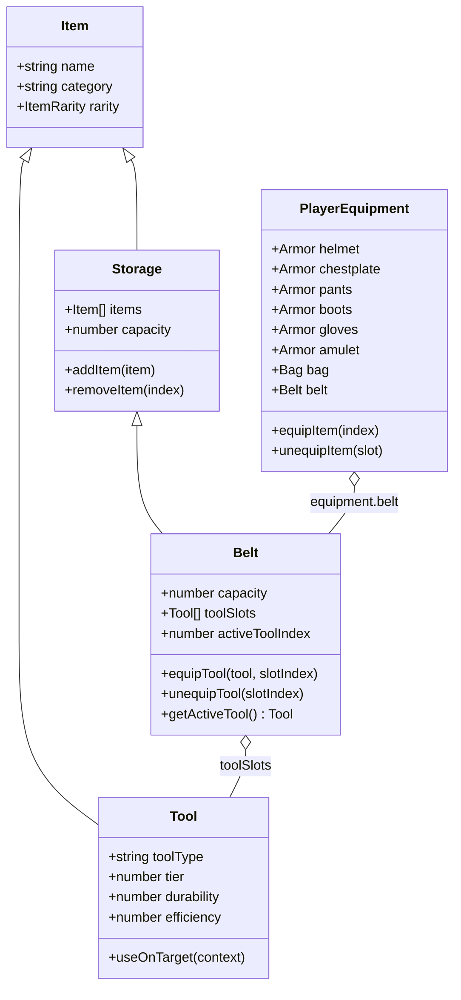

# Documento de Requisitos Futuros: Cinto de Utilidades, Ferramentas & Interações de Mundo

Este documento registra as diretrizes de game design, requisitos técnicos e a arquitetura planejada para a inclusão do **Cinto de Utilidades (Belt)**, o sistema de **Ferramentas (Tools)** e as fundações de interação contextual com o mundo.


- se tiver multiplayer, mapas custom

---

## 1. Visão Geral e Filosofia de Design

### 1.1 Não é um Sandbox Irrestrito
O jogo **não é um sandbox aberto total**. As mecânicas de manipulação do cenário são delimitadas por contexto geográfico e temático:
- **Áreas Urbanas (Cidades / Vilas):**
  - Espaços dedicados para **construção de casas**, expansão e **personalização residencial**.
  - O jogador constrói dentro de lotes ou áreas demarcadas das vilas e cidades, garantindo coerência urbana.
- **Áreas Rurais e Selvagens (Fora das Cidades):**
  - Locais específicos para **agricultura**: preparação do solo (arar terra), plantio de sementes e irrigação.
  - Zonas florestais ou bosques designados para **coleta e corte de árvores**.

### 1.2 Objetivo Imediato (Fundação & Comunicação)
Não implementar a física nem a lógica de colheita/construção/corte de imediato.  
O foco imediato é:
1. Disponibilizar o slot de **Cinto (Belt)** no Paperdoll (Equipamentos do Personagem).
2. O Cinto atuar como um **Storage acoplado** (adicionando um conjunto de slots dedicados ao inventário do jogador).
3. Permitir **equipar Ferramentas (Tools)** dentro dos slots desse Cinto.
4. Estabelecer o **canal de comunicação e barramento de eventos** entre Jogador, Cinto, Ferramentas e o Mundo, preparando o terreno para as mecânicas que virão depois.

## 3. Sistema de Ferramentas (Tools)

### 3.1 Categoria e Propriedades
As ferramentas são itens da categoria `'tool'`, equipáveis estritamente nos slots internos do Cinto.
Propriedades essenciais de uma `Tool`:
- `toolType`: Identificador do tipo da ferramenta (`'hoe'`, `'watering_can'`, `'axe'`, `'hammer'`).
- `tier`: Nível do material (Madeira, Pedra, Ferro, Ouro, Mithril, etc.).
- `durability`: Durabilidade atual e máxima.
- `efficiency`: Multiplicador de velocidade ou eficácia da ação.
- `energyCost`: Custo de estamina/energia ou mana por uso (se aplicável).

### 3.2 Catálogo Inicial de Ferramentas

| Ferramenta | Tipo (`toolType`) | Local de Uso Permitido | Função / Comportamento Futuro |
| :--- | :--- | :--- | :--- |
| **Enxada** | `hoe` | Zonas rurais / Fazendas fora das cidades | Modifica o tile de terreno para **terra arada (tilled soil)**, habilitando o uso de sementes. |
| **Regador** | `watering_can` | Zonas rurais / Canteiros | Molha o solo arado, iniciando ou acelerando o ciclo de crescimento das plantações. Requer reabastecimento em fontes de água. |
| **Machado** | `axe` | Bosques e florestas fora das cidades | Corta árvores demarcadas gerando madeira e seiva como recursos de crafting. |
| **Martelo** | `hammer` | Lotes urbanos / Interiores em cidades | Permite erguer paredes, posicionar pisos, móveis e reparar estruturas residenciais. |

---

## 4. Arquitetura de Domínio & Comunicação

### 4.1 Estrutura de Classes (Domínio)



### 4.2 Canal de Eventos (`IGameEvents.ts`)
Para manter a arquitetura desacoplada (Clean Architecture / Hexagonal), o Cinto e as Ferramentas se comunicam via despachante de eventos:

1. **Gestão de Equipamento do Cinto:**
   - `toolEquippedInBelt`: `{ beltSlotIndex: number, tool: Tool }`
   - `toolUnequippedFromBelt`: `{ beltSlotIndex: number, tool: Tool }`
   - `activeToolChanged`: `{ activeIndex: number, tool: Tool | null }`

2. **Gatilhos de Interação com o Mundo (Canal Futuro):**
   - `requestToolAction`:
     ```typescript
     {
       toolType: 'hoe' | 'watering_can' | 'axe' | 'hammer';
       playerPosition: { x: number, y: number };
       targetTilePosition: { x: number, y: number };
       targetTileType: string;
       zoneType: 'city' | 'wilderness' | 'farmland';
     }
     ```
   - `toolActionResult`:
     ```typescript
     {
       success: boolean;
       reason?: 'invalid_zone' | 'insufficient_durability' | 'wrong_tool' | 'obstacle';
       modifiedTile?: { x: number, y: number, newType: string };
     }
     ```

---

## 5. Requisitos de Apresentação: Magias Dinâmicas, Infusões & Metamorfose Demoníaca (Visual & HUD)

Este capítulo especifica como as mecânicas desenvolvidas no Domínio (`MageSpellCraftingRegistry`, `BladeInfusions`, `AbyssalDemonSpell` e `TransformationTemplate`) devem ser refletidas visualmente na tela pelo **Adaptador Web** (`typescript/adapters/web/`), pelo **Módulo de Renderização** (`renderModule/`) e pelas **HUDs/GUIs**.

```
[Domínio: Player & SpellRegistry]
          │  DTO: EntityRenderableState (DomainRenderState.ts)
          ▼
[Adaptador Web: RenderModule & HUDs]
   ├── 1. Canvas / WebGPU: Visual Tint, Visual Scale e Animação
   ├── 2. Aura e Efeitos de Partículas nos Golpes
   ├── 3. HUD de Status e Buffs (PlayerStatusHud)
   └── 4. HUD de Buffer de Feitiços (SpellBufferHud / Grimoire)
```

### 5.1 Requisitos Visuais na Entidade do Jogador (`GameObjectElement` / `LayeredGameObjectElement`)

1. **Aplicação de `visualTint` (Color Tinting do Sprite):**
   - **Requisito:** Quando o DTO do jogador contiver `visualTint` (ex: `#8B0000` para a Forma Demoníaca), o renderizador deve aplicar a tonalidade cromática sobre o sprite do Boneco de Trapos:
     - No **Canvas 2D**: Utilizar `ctx.globalCompositeOperation = 'source-atop'` ou tint em canvas offscreen com a cor especificada e opacidade de 35-45%.
     - No **WebGPU**: Passar o vetor de cor `vec4(r, g, b, a)` no buffer de instância do shader de fragmento.
   - **Critério de Aceite:** Ao conjurar o Demônio Abissal, o jogador fica visivelmente avermelhado/sombrio de forma imediata. Ao expirar o tempo (15s), o tint volta a `undefined` sem cortes abruptos.

2. **Aplicação de `visualScale` (Escala Dinâmica):**
   - **Requisito:** O DTO exporta `visualScale: number` (ex: `1.3` para o Demônio Abissal). O renderizador deve multiplicar as dimensões de desenho do sprite centralizado (`width * visualScale`, `height * visualScale`) preservando o ponto de ancoragem no solo (`anchor: 'bottom-center'`).
   - **Critério de Aceite:** O personagem cresce 30% na tela mantendo os pés alinhados com o piso da cena.

3. **Aura de Elemento da Arma (`elementalType`):**
   - **Requisito:** Quando o jogador estiver sob efeito de `blade_infusion_air` (`elementalType: 'air'`) ou `blade_infusion_light`, a arma equipada ou os punhos devem exibir uma sobreposição visual:
     - **Ar (`air`):** Rastro translúcido esbranquiçado/esverdeado nos frames de balanço da arma.
     - **Luz (`light`):** Brilho alargado ao redor do sprite da lâmina, refletindo visualmente os +50% de área de alcance.

---

### 5.2 Requisitos das HUDs e Interfaces de Usuário (HUD / GUI)

1. **HUD de Status e Buffs Ativos (`PlayerStatusHud` / `characterMenu`):**
   - **Requisito:** Consumir a lista `activeStatuses` do DTO do Player (`DomainRenderState.ts`).
   - **Exibição dos Novos Buffs:**
     - `abyssal_demon_active`: Ícone de crânio/chifres com barra circular de tempo restante decrescente (15s $\rightarrow$ 0s).
     - `blade_infusion_air`: Ícone de lâmina com turbilhão de vento e temporizador decrescente (5s $\rightarrow$ 0s).
     - `blade_infusion_light`: Ícone de lâmina radiante com indicação de "+50% Área" e temporizador decrescente (5s $\rightarrow$ 0s).
   - **Tooltip:** Ao passar o mouse sobre o ícone do buff, exibir nome, descrição e atributos concedidos.

2. **Feedback em Tempo Real do Buffer de Digitação (`SpellBufferHud`):**
   - **Requisito:** Criar um micro-widget minimalista e translúcido logo abaixo ou acima da barra de HP/Mana do Mago:
     - Conforme o jogador digita (`spell_0` a `spell_9`), exibir os glifos ou ícones das runas em sequência (ex: `[Self] [Potência] [Ar]`).
     - Ao disparar com sucesso (`Auto-Cast` aos 500ms ou tecla de confirmação), o buffer pisca em dourado/azul e se dissolve.
     - Se o buffer estourar (>9 runas) ou falhar por mana insuficiente, piscar em vermelho com efeito de "estilhaço rúnico".

---

### 5.3 Requisitos de Efeitos de Partículas e Feedback de Impacto (`IGameEvents`)

1. **Efeito `windGust` (Infusão de Ar):**
   - **Requisito:** Implementar o renderizador de partículas para o canal `particle` com efeito `'windGust'`:
     - Disparar 3 a 5 lâminas de vento curvas em tons de ciano/branco que se dissipam em 0.25 segundos na direção do golpe da espada.

2. **Efeito `lightFlash` (Infusão de Luz):**
   - **Requisito:** No canal `particle` com efeito `'lightFlash'`:
     - Flash esférico radiante amarelado/dourado com fade-out suave em 0.2 segundos, enfatizando a grande área atingida.

3. **Efeito `fireExplosion` + `darkPulse` (Transmutação Demoníaca):**
   - **Requisito:** Ao entrar na forma demoníaca, disparar a sobreposição simultânea de fogo vermelho e pulso negro expansivo centrada nas coordenadas do jogador.

