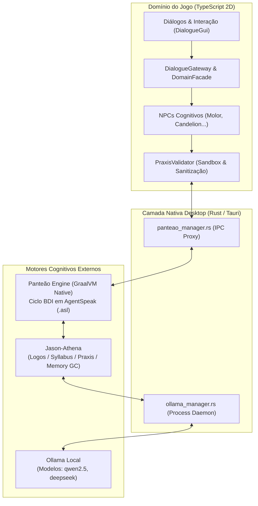

# Pesquisa: Panteão e Jason-Athena

Documentação focada estritamente nos dois pilares de pesquisa que sustentam o sistema cognitivo e o motor multiagente do **`rpg-roguelite-game`**.

---

## 1. Módulos de Pesquisa Ativos

| Documento | Origem no Workspace | Papel no Projeto |
| :--- | :--- | :--- |
| **[`01_panteao.md`](file:///home/kkphoenix/Documents/Workspace/rpg-roguelite-game/docs/research/01_panteao.md)** | `/home/kkphoenix/Documents/Workspace/1. Pesquisa/Panteão` | Motor BDI nativo em GraalVM (`panteao-engine`). Executado como processo sidecar pelo backend Tauri (`src-tauri/src/panteao_manager.rs`), comunicando-se via socket IPC bidirecional com a `DomainFacade`. |
| **[`02_jason_athena.md`](file:///home/kkphoenix/Documents/Workspace/rpg-roguelite-game/docs/research/02_jason_athena.md)** | `/home/kkphoenix/Documents/Workspace/1. Pesquisa/jason-athena` | Extensão para raciocínio generativo BDI + LLM (Ollama). Provê o Córtex Generativo (Logos, Syllabus, Praxis) e inspirou o [`PraxisValidator.ts`](file:///home/kkphoenix/Documents/Workspace/rpg-roguelite-game/typescript/domain/ObjectModule/Entities/NPCs/PraxisValidator.ts) para sandbox e proteção contra alucinações. |
| **[`AgentSpeak_Jason_Rules.md`](file:///home/kkphoenix/Documents/Workspace/rpg-roguelite-game/docs/research/AgentSpeak_Jason_Rules.md)** | Especificação Canônica / Prática | Manual de regras, sintaxe lógica pura, ciclo SOS, plano de contingência e ações internas do AgentSpeak/Jason adotados no projeto. |

---

## 2. Arquitetura Integrada no Jogo

